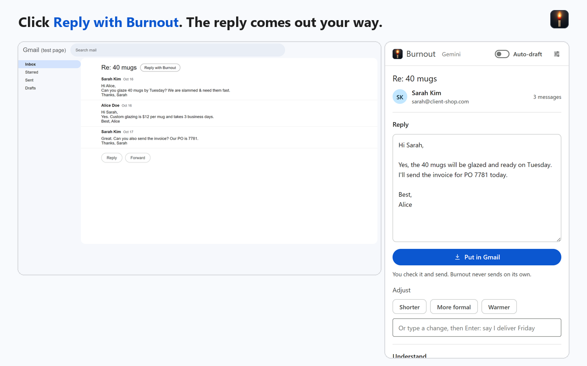

# Burnout for Gmail

Your own AI email assistant for Gmail: it writes your replies your way, with the AI you choose.
Open an email, click **Reply with Burnout**, check the reply and send it. Burnout never sends on
its own.

Free and open source ([github.com/Prepvia/Burnout.v1.0](https://github.com/Prepvia/Burnout.v1.0)):
no server, no account, nothing to buy. Everything stays in your browser, and your emails go only to
the AI you pick.

**[Download burnout-for-gmail.zip](https://github.com/Prepvia/Burnout.v1.0/releases/latest/download/burnout-for-gmail.zip)** (not
"Source code") · **[Illustrated guide](docs/Burnout-manual.pdf)** (PDF, every screen, clicks counted)



## No time? Try it in 3½ minutes

Four steps, from nothing to your first reply. You need Google Chrome on a computer (Windows or Mac)
and Gmail. Burnout is a Chrome extension, a small add-on for Chrome, so it doesn't run on phones.
No code: you only click, paste and type.

1. **Download it.** Click [Download burnout-for-gmail.zip](https://github.com/Prepvia/Burnout.v1.0/releases/latest/download/burnout-for-gmail.zip).
   Not "Source code": Chrome can't load that one as is. Unzip it: on Windows, right-click the file,
   then **Extract All** and **Extract**; on a Mac, double-click it. You get a `burnout-for-gmail`
   folder. Keep it: Chrome runs Burnout from it.
2. **Load it in Chrome.** Go to `chrome://extensions` (or Chrome's ⋮ menu, then **Extensions**,
   then **Manage Extensions**). Turn on **Developer mode** (top right) and leave it on: Burnout only
   runs while it's on. Click **Load unpacked**, pick the `burnout-for-gmail` folder and click
   **Select Folder** (**Select** on a Mac).
3. **Connect a free AI.** The setup page opens by itself. Click **Open the key page** and sign in
   to Google (accept Google's terms if asked). Click **Create API key** and copy the new key (it
   starts with AQ.). Back in Burnout, paste it (Ctrl+V, or Cmd+V on a Mac) and click **Test and
   save**. Then type your name, what you do and how you sign off (for example *Best,
   Alice*), and click **Continue**.
4. **Reply.** In Gmail, open an email and click **Reply with Burnout**. Read the reply, click
   **Put in Gmail**, and send it yourself.

On Gemini's free plan, Google uses what you send to improve its products, and people at Google may
read it. Google asks you not to send personal or confidential information there, so try Burnout on
an email with nothing private in it. For customer email, turn on billing in Google AI Studio (from
$5) or connect another AI ([Your AI](#your-ai)).

**To update:** in Settings, Memory, click **Download backup**, just in case. Download the new
[`burnout-for-gmail.zip`](https://github.com/Prepvia/Burnout.v1.0/releases/latest/download/burnout-for-gmail.zip)
and unzip it. (Settings shows your version, with a **Check for updates** link to the releases.) In `chrome://extensions`, click **Load unpacked** and pick the
new folder: Burnout updates and keeps your settings and memory. Reload Gmail. You can then delete
the old folder. Changed a file ([Make it yours](#make-it-yours))? Make the same change again in the
new folder before you load it. Don't copy your old file over: the new version may have changed that
file too.

**Another computer:** Chrome doesn't copy Burnout to your other computers. Install it there, then
click **Already use Burnout? Restore a backup** on the first setup screen and pick your backup file.

## What it does

- **Reply with Burnout**: a button next to the subject of every email. One click opens the panel
  and the reply shows up as it is written, in the sender's language, with your name, services,
  hours, booking link and sign-off, and never promising what you told it not to.
- **Put in Gmail**: puts the reply in the conversation's reply box, above your Gmail signature.
  Gmail saves it as a draft. Putting it in again replaces the previous version instead of adding a
  copy.
- **Auto-draft** (a switch at the top of the panel, off until you turn it on): with the panel open,
  opening an email gets its reply written and waiting as a Gmail draft, with no clicks. It skips
  emails where you wrote last, robot senders (no-reply, notifications) and a reply box that's
  already open.
- **Adjust**: Shorter, More formal, Warmer, or type what to change ("say I deliver Friday") and
  press Enter. What you ask for becomes a note on that conversation and goes into its next replies;
  you can see and delete each note.
- **Understand**: Explain this email (summary, what they want, full translation), Selected text
  (what a sentence really means) and Ask (a chat about the email that can write the reply for you).
- **Remember**: facts it keeps in every reply, or only for one person ("Sarah wants invoices as a
  PDF").
- **Learn from my sent mail**: reads emails you already sent and picks up how you write and the
  facts that keep coming up. A price you gave one client stays with that client.
- **Backup** to a file, to move everything to another computer. **Alt+J** (Option+J on a Mac)
  opens the panel.

## Make it yours

Burnout is open source: every file is yours to change. Most changes need no code at all.

### Without touching a file

| You want | Where |
|---|---|
| Replies that sound like you | **Settings > Your business**: what you do and how you sign off. Then **Learn from my sent mail** in the panel. |
| Your prices, hours, booking link, tone, what to never promise | **Settings > Your business > More details**. |
| A fact it must always use | **Remember** in the panel, or the **Memory** tab in Settings. |
| Another AI, or your company's own | **Settings > AI** ([Your AI](#your-ai)). |
| Drafts already waiting in Gmail | The **Auto-draft** switch at the top of the panel. |

### Change the files, with an AI's help

For what Settings can't do: other words on a button, other colors, new rules for how it writes.
You don't need to know code. Only use changes you asked an AI for yourself, never files someone
sends you: Burnout can read your Gmail.

1. **Back up first**: Settings, Memory, **Download backup**. Then make a copy of the
   `burnout-for-gmail` folder, so you can always go back.
2. **Open the file** for what you want to change (table below): right-click it, then **Open with**,
   **Notepad** (on a Mac: right-click, **Open With**, **TextEdit**). On Windows, don't double-click
   a `.js` file: Windows tries to run it.
3. **Ask an AI** such as Claude or ChatGPT: paste the whole file and say what you want, for
   example *rename the Put in Gmail button to Insert reply*. Ask it to send back the complete file,
   with nothing left out. If its answer is clearly shorter than the file you pasted, or says
   something like "rest unchanged", ask again.
4. **Paste it over the old text**: in Notepad, select everything (Ctrl+A, or Cmd+A on a Mac), paste
   the new file and save (Ctrl+S, or Cmd+S).
5. **Reload.** In `chrome://extensions`, click the round arrow on Burnout's card, then reload Gmail.
   Never click **Remove**: it deletes your settings and memory.

Something broke? Copy the file you changed from your copy back into the `burnout-for-gmail` folder
(choose Replace) and click the round arrow again. Keep using the original folder. An update
replaces the files you changed, so keep a note of what you asked for.

### Which file does what

`lib/prompts.js` means the `prompts.js` file inside the `lib` folder. (In this repository, they're
all inside the `extension` folder.)

| File | What it holds |
|---|---|
| `lib/prompts.js` | How Burnout writes: the instructions it sends to the AI. |
| `lib/i18n.js` | Every word you see in the panel and in Settings, the name at the top included. |
| `_locales/en/messages.json` | The name in Chrome, and the button in Gmail (Reply with Burnout). |
| `ui.css` | The colors, sizes and spacing of the panel. |
| `icons/` | The logo: four square pictures, `icon16.png`, `icon32.png`, `icon48.png` and `icon128.png` (16, 32, 48 and 128 pixels). Replace them with yours, same names. |
| `lib/ai.js` | How it talks to each AI. Leave this one to a developer. |

## Your AI

| AI | How to connect it | Cost |
|---|---|---|
| Google Gemini (`gemini-3.8-flash`) | paste the key (`AQ.` or `AIza...`) | free plan for trying; billing from $5 |
| ChatGPT / OpenAI (`gpt-6.1-sol`, `gpt-6-luna`, `gpt-6-astra`) | paste the key (`sk-...`) | pay per use, with API credit: a ChatGPT subscription doesn't cover it |
| Claude / Anthropic (`claude-sonnet-5-5`, `claude-haiku-5-5`, `claude-opus-5-5`) | paste the key (`sk-ant-...`) | pay per use, with API credit: a Claude subscription doesn't cover it |
| Other AI: OpenRouter, Groq, Mistral, DeepSeek, xAI, Together, Ollama, LM Studio | pick the service, paste its key, click **Load models** | the service's price, or free on your computer |
| Company AI | your server's HTTPS address (and key, if it has one) | yours |

Burnout recognizes which AI a key belongs to. Gemini keys made since May 2026 start with `AQ.`; an
old `AIza` key that isn't restricted to the Gemini API no longer works, so make a new one. You pay
your AI provider directly, or nothing with Gemini's free plan or a local model. Running a model on
your own computer with Ollama: start Ollama with `OLLAMA_ORIGINS=chrome-extension://*` (it refuses
browser extensions otherwise) and, for long emails, `OLLAMA_CONTEXT_LENGTH=16384`. Details, and the
small contract for plugging in your own server: [docs/CONNECT_AI.md](docs/CONNECT_AI.md).

## Privacy

Your AI key, profile, memory and chats stay in your browser (`chrome.storage.local`). An email
leaves the browser only to the AI you chose, when you ask for something (or when you open an email
with Auto-draft on). Burnout never sends, deletes or archives email. Details:
[docs/PRIVACY.md](docs/PRIVACY.md).

## For developers

Plain JavaScript (Manifest V3), with no build step and no dependencies.

- **Run it from the code:** `git clone https://github.com/Prepvia/Burnout.v1.0` (or **Code >
  Download ZIP**), then in
  `chrome://extensions` click **Load unpacked** and pick the `extension` folder. After a change,
  click the round arrow on Burnout's card.
- **One ID everywhere:** `manifest.json` has a fixed `"key"`, so Burnout's ID is
  `njkplofhmkamkdeebicjgdfonjgblmfg` whatever folder it's loaded from. That's what lets an update
  loaded from a new folder keep the settings. Want your own copy next to the original? Delete the
  `"key"` line in your copy.
- **Make the download:** `python scripts/package.py` writes `dist/burnout-for-gmail.zip`, with the
  `extension` folder's files at the zip's root (plus the LICENSE). That zip is what each
  [release](https://github.com/Prepvia/Burnout.v1.0/releases) carries, always under the same name,
  so the download link above never changes.

### How it's tested

```
node tests/run.mjs            # 58 tests, no dependencies (Node 18+)
python scripts/e2e.py         # the real extension in Chromium on a test Gmail page, with simulated AIs
python scripts/live_check.py  # the real extension against a real model on your computer (Ollama)
```

The two Python scripts need `pip install playwright` and `playwright install chromium`;
`live_check.py` also needs [Ollama](https://ollama.com) with `qwen2.5:7b` (or pass `--model`).

What has been checked for real, on October 17, 2026:

- **With a real AI:** `live_check.py` ran the whole flow (setup, the Gmail button, Put in Gmail,
  a typed change with notes, Shorter, Explain, Ask, Remember, Learn, Auto-draft) against qwen2.5 7B and 14B,
  with nothing simulated on the AI side.
- **The download:** `burnout-for-gmail.zip` unzipped and loaded in Chromium opens the setup page by
  itself; loaded again from another folder, it stays one Burnout with the same settings.
- **On a real Gmail (read only):** the selectors (`h2.hP`, `span.ams.bkH`, `tr.zA`, the reply
  box), reading 15 conversations through Gmail's print page (up to 70 messages) and listing sent
  mail by date range. In 37 more conversations, every message sat at the same level of the page,
  which is what stops a fake "message from you" hidden inside an email. If Gmail changes,
  `extension/content.js` and `extension/lib/gmail_parse.js` are the only places to fix.
- **Not yet checked on a real Gmail:** putting the reply into the reply box, the panel opening from
  the button and Alt+J, and a real Gemini, OpenAI or Anthropic key. They pass the end-to-end test
  and follow Chrome's and the providers' documented behavior.

### Project layout

```
extension/              the extension (Manifest V3, no build step, no dependencies)
  manifest.json         permissions: storage, side panel, Gmail and the three main AIs; any other
                        AI address is asked for when you add it. The "key" fixes the ID
  background.js         opens the panel (icon, Alt+J, the Gmail button) and the setup page
  content.js            inside Gmail: the open conversation, Sent mail, putting the reply in, the button
  panel.html/.js        the side panel
  options.html/.js      setup and settings
  ui.css                the look
  lib/ai.js             the AI providers, with streaming
  lib/prompts.js        what goes to the AI
  lib/gmail_parse.js    reads Gmail's print page
  lib/learn.js          learning from sent mail
  lib/store.js          memory, notes, backup (all in the browser)
  lib/i18n.js           screen text
tests/                  unit tests and a fake Gmail
scripts/                end-to-end test, live check with a real AI, icon, download zip
docs/                   the illustrated guide (PDF), connecting your AI, privacy
```

## License

MIT: use it, change it, share it. See [LICENSE](LICENSE).

Gmail is a trademark of Google LLC. Burnout is not made or endorsed by Google.
